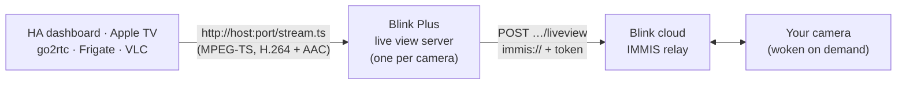

<p align="center">
  <picture>
    <source media="(prefers-color-scheme: dark)" srcset="docs/images/logo-dark.png">
    
  </picture>
</p>

<p align="center">
  <b>Live view for Blink cameras and doorbells in Home Assistant, Apple Home, go2rtc and Frigate.</b><br>
  Built on top of the official Blink integration, with the one thing it can't do: watching your cameras live.
</p>

<p align="center">
  <a href="https://github.com/hacs/integration"></a>
  <a href="https://github.com/akramercury/ha-blink-plus/releases"></a>
  <a href="https://github.com/akramercury/ha-blink-plus/actions/workflows/validate.yml"></a>
  
  <a href="LICENSE"></a>
</p>

---

## Why

Home Assistant's built-in Blink integration says it plainly: *"This integration does NOT allow for live viewing of your Blink camera."* Blink Plus adds live view, and keeps everything else (login, sensors, arm/disarm, snapshots, clips).

It speaks Blink's own live view protocol (**IMMIS**), reverse engineered from the current Blink Android app. It turns each camera into a plain MPEG-TS stream that Home Assistant, HomeKit, go2rtc, Frigate and VLC can all play.

## Features

| | |
|---|---|
| 🎥 **Live view** | Outdoor / Indoor (Sync Module), Mini and Video Doorbell, including the new v6 live view API and `liveview_token` |
| 🍎 **Apple Home & Apple TV** | Through HA's HomeKit Bridge. Doorbells can pop up picture-in-picture on Apple TV |
| 🔁 **Seamless sessions** | Blink ends live views after a short time limit. Blink Plus continues with `extended_liveview`, like tapping *Continue* in the app |
| 🧠 **Sync-module friendly** | One live view per system, no polling during live view, no background USB scans, never retries a failing camera. The Blink app keeps working |
| 🔐 **Login that works in 2026** | OAuth v2 + PKCE, 2FA (email/SMS), per-install device ID, token refresh, and clear error messages |
| 📊 **Everything from the built-in integration** | Alarm panel (arm/disarm), motion, battery, temperature, Wi-Fi, motion detection switch, snapshots, clip saving |
| 💾 **Clip archive** | Copies clips to a folder or straight onto your PC, **with or without a Blink plan** (cloud clips or Sync Module USB clips) |
| 🩺 **Diagnostics** | Per-camera live view state and the reason for any failure, plus a log of the last 150 Blink API calls |
| 🖼️ **Proper branding** | Icon and logo show in Home Assistant 2026.3+ |

## How it works



* **Nothing runs while nobody is watching**, so idle cameras use no battery and don't touch the sync module.
* When the first viewer connects, the camera wakes up (5–10 s for battery cameras). Several viewers share **one** Blink session.
* When the last viewer leaves, the session is ended **the same way the Blink app ends it** (IMMIS `STOP`, then closing the command), so the camera and sync module are released right away.

## Installation

### HACS (recommended)

[](https://my.home-assistant.io/redirect/hacs_repository/?owner=akramercury&repository=ha-blink-plus&category=integration)

Or by hand:
1. HACS → ⋮ → **Custom repositories**
2. Repository: `https://github.com/akramercury/ha-blink-plus`, type **Integration** → Add
3. Search for **Blink Plus** → Download → **restart Home Assistant**

### Manual

1. Download the latest release and copy `custom_components/blink_plus` to `/config/custom_components/blink_plus`
2. Restart Home Assistant

### Set up

[](https://my.home-assistant.io/redirect/config_flow_start/?domain=blink_plus)

**Settings → Devices & services → Add integration → Blink Plus**
1. Sign in with the **email address** and password you use in the Blink app
2. Enter the 2FA code Blink emails or texts you
3. Each camera now appears as `camera.<name>` with streaming. Open it and live view starts.

> [!TIP]
> Blink Plus replaces the built-in **Blink** integration. Running both works, but you'll get duplicate entities, and the built-in one keeps polling your sync module. Once Blink Plus works, remove the built-in one.

## Configuration

**Settings → Devices & services → Blink Plus → Configure**

| Option | Default | What it does |
|---|---|---|
| Scan interval | `300` s | How often sensors and thumbnails refresh (from Blink's cloud, not the sync module) |
| Live view listen address | `127.0.0.1` | Set `0.0.0.0` if go2rtc / Frigate / VLC run on **another** machine |
| First live view TCP port | `0` (random) | e.g. `18550` gives fixed ports: cameras are sorted by serial and get 18550, 18551, … |
| Max live view minutes | `5` | Per viewing. Protects batteries if a tab is left open. `0` = unlimited |
| Linger | `5` s | Keeps the session this long after the last viewer leaves (quick re-open) |
| Live view token mode | `auto` | `auto` uses the app's `liveview_token` and falls back to zeros. Change it only if support asks you to |
| USB clip list check (minutes) | `0` (off) | Reads the Sync Module 2 USB clip list for motion. **Any value can make the Blink app show "system busy"** while it runs |

## Clip archive: copy your videos to your PC

Blink Plus can copy every new clip into a folder on its own. Point that folder at a share on your PC, and your Blink videos land on your computer automatically, organised by camera and day:

```
Blink/
├── Front Door/
│   └── 2026-10-22/
│       ├── Front Door_2026-10-22_08-14-03.mp4
│       └── Front Door_2026-10-22_17-42-51.mp4
└── Driveway/
    └── 2026-10-22/
        └── Driveway_2026-10-22_12-05-37.mp4
```

| Your setup | Where clips come from | Effect on the sync module |
|---|---|---|
| **Blink subscription** | Blink's cloud | None. It even runs during live view |
| **No subscription**, Sync Module 2 + USB stick | The USB stick (the sync module uploads each clip, then Blink Plus downloads it) | One clip at a time, with pauses. Never during live view; it stops if you open one |
| Both | Both, automatically | |

### 1. Share a folder from your PC
*Windows:* create a folder (e.g. `D:\Blink`) → right-click → **Properties → Sharing → Advanced Sharing** → share it as `Blink` and give your Windows user *Change* permission.

### 2. Add it to Home Assistant
**Settings → System → Storage → Add network storage**
* Name: `blink` · Usage: **Media** · Server: your PC's IP · Protocol: **Samba/Windows (CIFS)**
* Remote share: `Blink` · your Windows username and password

The share now appears inside Home Assistant as `/media/blink`.

> Network storage needs Home Assistant OS or Supervised. On other installs, use any folder under `/media` (or one listed in `allowlist_external_dirs`) and reach it however suits you, e.g. the Samba add-on.

### 3. Turn on the archive
**Settings → Devices & services → Blink Plus → Configure**

| Option | Example | |
|---|---|---|
| Copy USB clips to this folder | `/media/blink` | Empty = archive off |
| Copy new clips every N minutes | `60` | `0` = only with the button or action |
| Only copy clips from the last N hours | `24` | `0` = everything (first full copy) |

Then press **Archive clips now** (on the *Blink Plus* device) for a first run, or wait for the schedule. The **Last archived clip** sensor shows progress, counts, the last file and any error.

> [!TIP]
> No subscription? Copying from the USB stick uses the sync module, so the Blink app may briefly say *"system busy"* while a clip is being copied. Running every 60 minutes (or overnight with an automation calling `blink_plus.archive_clips`) keeps that out of your way.

**Automation idea:** get a phone notification with the camera name whenever a clip lands on your PC:

```yaml
automation:
  - alias: Blink clip saved
    triggers:
      - trigger: event
        event_type: blink_plus_clip_saved
    actions:
      - action: notify.mobile_app_my_phone
        data:
          message: "New {{ trigger.event.data.camera }} clip saved"
```

## Apple Home / Apple TV

Add each camera to HA's **HomeKit Bridge** in *accessory mode* (required for cameras):

```yaml
homekit:
  - name: Front Doorbell
    port: 21065
    mode: accessory
    filter:
      include_entities:
        - camera.front_door
    entity_config:
      camera.front_door:
        video_codec: copy          # Blink already sends H.264
        support_audio: true
        linked_doorbell_sensor: binary_sensor.front_door_motion
        linked_motion_sensor: binary_sensor.front_door_motion

  - name: Driveway
    port: 21066
    mode: accessory
    filter:
      include_entities:
        - camera.driveway
    entity_config:
      camera.driveway:
        video_codec: copy
        support_audio: true
```

Restart, pair each accessory with the code from the HA notification (Home app → **+** → Add Accessory → More options), and turn on camera/doorbell notifications on the Apple TV (Settings → AirPlay and HomeKit).

* With `linked_doorbell_sensor`, the Apple TV shows the doorbell picture-in-picture when it triggers.
* Black tile in the Home app? Use `video_codec: libx264` instead of `copy`.
* HomeKit Secure Video isn't available through HA's HomeKit Bridge.
* Home app snapshots use the last Blink thumbnail. Blink Plus never wakes a camera just to refresh a tile.

> [!NOTE]
> HA's built-in HomeKit Bridge (UI-configured) can hold at most 150 accessories. If you see *"would exceed the 150 device limit"*, filter that bridge so it doesn't also include the Blink Plus entities.

## go2rtc · Frigate · VLC

Set **Live view listen address** to `0.0.0.0` and a fixed **First live view TCP port** (e.g. `18550`). Each camera's URL is in its `live_view_url` attribute.

```yaml
# go2rtc.yaml
streams:
  front_door: http://<ha-ip>:18550/stream.ts
```

```bash
vlc http://<ha-ip>:18550/stream.ts
```

> [!WARNING]
> Don't point Frigate *detection* at battery cameras. A 24/7 stream drains a Blink battery in hours. Use them for on-demand viewing only.

## Being nice to your Sync Module

A Blink Sync Module can only do **one job at a time**. If it's busy, the Blink app shows *"system busy"*. Blink Plus is built around that:

| Situation | What Blink Plus does |
|---|---|
| You open a second camera on the same system | Ends the first live view (and HA's stream for it), then starts the new one. Never two at once |
| A camera doesn't send video (asleep, low battery, weak Wi-Fi) or Blink refuses | **One** attempt, a clean stop, then a 2-minute cool-down (`live_view_cooldown_s`). HA's automatic reconnects send nothing to Blink |
| A viewer stays open past *Max live view minutes* | Stops, then rests for 60 s so a player that keeps reconnecting can't restart it |
| A live view is running | Background polling is paused |
| Regular polling | Reads Blink's cloud homescreen only. No sync module commands, no per-camera signal requests, no USB clip uploads |
| USB clip list | Not read unless you enable it |

After you close a camera in HA, it's released within about **35 seconds** (HA keeps its player alive ~30 s, plus the 5 s linger). If the Blink app says busy right after you close a camera, wait that long.

## Entities, actions and attributes

**Entities per camera:** camera (with streaming), motion, battery, temperature, Wi-Fi signal, motion-detection switch. **Per system:** alarm control panel (arm / disarm). **With the clip archive on:** *Archive clips now* button and *Last archived clip* sensor.

| Action | |
|---|---|
| `blink_plus.stop_live_view` | End a camera's live view now |
| `blink_plus.archive_clips` | Copy new clips to the archive folder now (`hours`, `max_clips`); returns a summary |
| `blink_plus.trigger_camera` | Take a new snapshot (wakes the camera) |
| `blink_plus.record` | Record a clip |
| `blink_plus.save_video` | Save the last clip to a file |
| `blink_plus.save_recent_clips` | Save recent clips to a folder |

| Camera attribute | Meaning |
|---|---|
| `live_view_state` | `idle` · `starting` · `streaming` · `error` |
| `live_view_last_error` | Why the last attempt failed (Blink's message, or "camera sent no video …") |
| `live_view_cooldown_s` | Seconds before this camera may start again |
| `live_view_viewers` | Who is connected to the stream right now |
| `live_view_url` | Local MPEG-TS URL for go2rtc / VLC |

## Troubleshooting

<details>
<summary><b>"Invalid authentication" when signing in</b></summary>

* Use the **email address** of your Blink account, not a nickname or username.
* The form now says why login failed: wrong password, wrong 2FA code, **rate limited**, or the Blink step that failed.
* Rate limited? Wait 15–30 minutes before trying again. Every retry resets Blink's timer.
</details>

<details>
<summary><b>The Blink app says "system busy"</b></summary>

1. Make sure the built-in Blink integration is removed. It polls the sync module on its own.
2. Check each camera's `live_view_state` and `live_view_viewers`. If one is still streaming, something (a dashboard card set to live, a forgotten tab) is still watching. Use `camera_view: auto` on dashboard cards.
3. Make sure **USB clip list check** is `0`.
4. Still stuck? Unplug the sync module for 10 seconds, then download diagnostics (see below).
</details>

<details>
<summary><b>A camera doesn't stream</b></summary>

Look at `live_view_last_error`:
* *camera sent no video …* usually means low battery, weak Wi-Fi, or the camera was asleep. Try again after the cool-down.
* A message from Blink means Blink refused the request (e.g. the system is busy or the camera is offline).
* *Unsupported live view transport …*: please open an issue with debug logs.
</details>

<details>
<summary><b>Debug logs and diagnostics</b></summary>

```yaml
logger:
  logs:
    custom_components.blink_plus: debug
```

**Settings → Devices & services → Blink Plus → ⋮ → Download diagnostics** gives each camera's live view state and the last 150 Blink API calls. Tokens, serials and email are redacted. Please attach it to [bug reports](https://github.com/akramercury/ha-blink-plus/issues/new/choose).
</details>

## Roadmap

- [x] Live view (IMMIS, v6 + token, extended sessions, clean STOP)
- [x] Apple Home / Apple TV via HomeKit Bridge
- [x] Sync-module protection
- [ ] **Push notifications** (Firebase, like the app): instant doorbell press events and motion/person/vehicle detection, without polling
- [x] Clip archive to a folder / PC (cloud and USB)
- [ ] Snooze, chime test, lights, Mini-as-chime
- [ ] Two-way talk

## Development

The live view engine has offline tests that run against a fake Blink IMMIS relay and real ffmpeg, so no Blink account is needed. See [`tests/`](tests/). Every push runs them in CI, together with HACS and hassfest validation.

## Credits & disclaimer

* Based on Home Assistant's [`blink`](https://www.home-assistant.io/integrations/blink/) integration (Apache-2.0) and [blinkpy](https://github.com/fronzbot/blinkpy) (MIT). IMMIS framing was first documented by blinkpy and blink-liveview-middleware.
* Endpoint, token and protocol details come from the Blink Android app 60.0 (see [`docs/blink-api-map.md`](docs/blink-api-map.md)).

**Blink Plus is an independent community project. It isn't affiliated with, endorsed by or sponsored by Blink or Amazon.** "Blink" is a trademark of Amazon.com, Inc. or its affiliates. The project uses an unofficial API that can change at any time. Use it at your own risk.

Licensed under the [Apache License 2.0](LICENSE).
